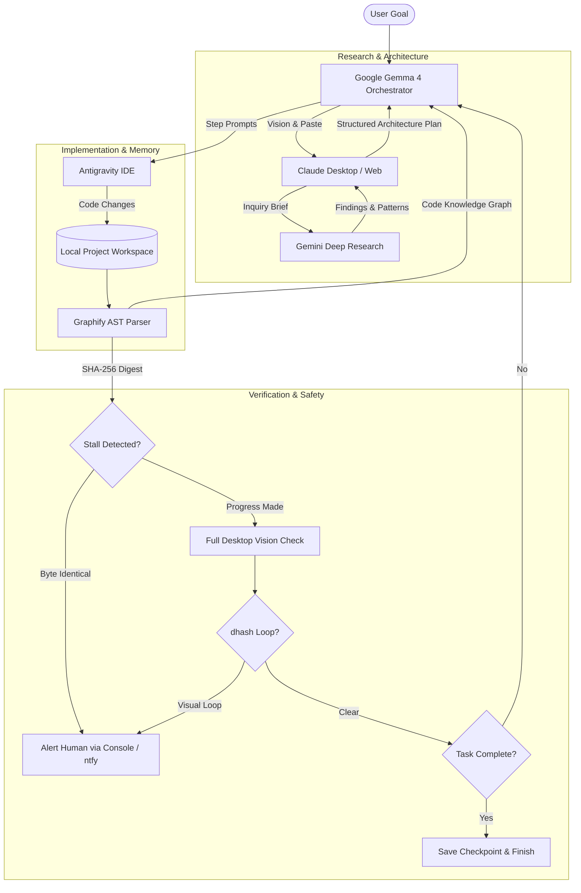

<div align="center">

# 🤫 Hush

### *Builds quietly. Speaks only when it must.*

[](https://github.com/akshayjadhav237237-cmd/hush-agent/actions/workflows/agent-tests.yml)
[](LICENSE)
[](https://python.org)
[](https://typescriptlang.org)
[](https://microsoft.com)
[-4285F4?logo=google&logoColor=white)](https://deepmind.google/technologies/gemma/)

**An autonomous Windows desktop agent orchestrator powered by Google Gemma 4.**  
Hush coordinates Claude for system architecture, Gemini Deep Research for investigation, and Antigravity for code generation. Safe operations run completely in the background; Hush pauses to alert you only when human judgment is strictly required.

[**Explore Live Showcase**](https://akshayjadhav237237-cmd.github.io/hush-agent/) • [**Interactive Simulator**](https://akshayjadhav237237-cmd.github.io/hush-agent/#simulator) • [**Agent Runner Guide**](agent/README.md) • [**Architecture Diagram**](https://akshayjadhav237237-cmd.github.io/hush-agent/#architecture-diagram)

---

</div>

## 📑 Table of Contents

- [The Problem & The Hush Thesis](#-the-problem--the-hush-thesis)
- [How Hush Works](#-how-hush-works)
- [System Architecture](#-system-architecture)
- [Multi-Model Coordination](#-multi-model-coordination)
- [Codebase Memory with Graphify](#-codebase-memory-with-graphify)
- [Security & Defense-in-Depth Guardrails](#-security--defense-in-depth-guardrails)
- [Quickstart: Run It Yourself](#-quickstart-run-it-yourself)
  - [1. Simulated Demo Mode (No Live Keys Required)](#1-simulated-demo-mode-no-live-keys-required)
  - [2. Live Desktop Execution](#2-live-desktop-execution)
  - [3. Resuming Interrupted Runs](#3-resuming-interrupted-runs)
  - [4. Comparing Runs & Token Usage](#4-comparing-runs--token-usage)
- [Emergency Kill Controls](#-emergency-kill-controls)
- [Tool Registry](#-tool-registry-22--23-tools)
- [Web Showcase](#-web-showcase)
- [Known Limitations & Truth in Engineering](#-known-limitations--truth-in-engineering)
- [License](#-license)

---

## 💡 The Problem & The Hush Thesis

Most autonomous desktop agents suffer from **notification exhaustion**: they constantly pause to ask trivial questions ("Should I click this button?", "Should I continue?"), training operators to blindly click "Approve" without reading.

**Hush inverts this paradigm.**
Benign tasks run silently and autonomously at machine speed. Hush escalates to the human operator only when it encounters an insurmountable gate:

| Escalation Trigger | Enforcement Mechanism | What Happens |
|:---|:---:|:---|
| **Auth & Security Prompts** | Model-Judged | Halts immediately for CAPTCHAs, 2FA, logins, or biometrics. |
| **Missing Secrets & Quotas** | Code + Model | Pauses cleanly when missing environment variables or API quotas. |
| **Ambiguous Requirements** | Model-Judged | Halts if Claude flags `NEEDS_HUMAN` or user requirements branch. |
| **Dangerous Shell Commands** | Code-Enforced | Hard rejection of non-allowlisted binaries, command chaining, or directory escapes. |
| **Code Generation Stalls** | Code-Enforced | Alerts human if the Graphify AST report hash is byte-identical across 2 consecutive rounds. |
| **Visual Stagnation Loops** | Code-Enforced | Perceptual difference hashing (`dhash`) breaks repetitive UI clicking loops. |

---

## 🔄 How Hush Works



---

## 🏛️ System Architecture

Hush treats **Google Gemma 4** (`gemma-4-26b-a4b-it`) as an uncompromising control plane and vision evaluator.

```
       +-------------------------------------------------------------+
       |                       Human Operator                        |
       +-------------------------------------------------------------+
                                      ^
                                      | High-priority escalations only
                                      v
       +-------------------------------------------------------------+
       |                 Google Gemma 4 Orchestrator                 |
       |             (Control Plane, Vision & Gatekeeper)            |
       +-------------------------------------------------------------+
              /                       |                       \
             /                        |                        \
            v                         v                         v
+------------------------+ +------------------------+ +------------------------+
|  Gemini Deep Research  | |         Claude         | |      Antigravity       |
|  (In-depth Web Mining) | |  (Architecture & Spec) | |   (IDE Code Editor)    |
+------------------------+ +------------------------+ +------------------------+
                                      |
                                      v
                               +--------------+
                               |   Graphify   |
                               | (AST Memory) |
                               +--------------+
```

### 🔁 End-to-End Execution Lifecycle
1. **Intake**: Operator specifies the application or idea to construct (`orchestrator.py "Build an offline kanban board"`).
2. **Research Synthesis**: Claude produces a targeted inquiry brief for external exploration.
3. **Deep Investigation**: Gemini Deep Research analyzes reference architectures, interface conventions, and dependencies.
4. **Specification**: Claude synthesizes research findings into step-by-step modular build directives.
5. **Execution**: Antigravity writes and modifies files directly within the local workspace.
6. **Code Graph Ingestion**: Graphify parses the repository via local tree-sitter AST extraction into an interactive knowledge graph (`graph.html`).
7. **Cryptographic Stall Check**: If `graphify-out/GRAPH_REPORT.md` produces identical SHA-256 hashes across consecutive cycles, execution pauses and alerts the operator.
8. **Vision Verification**: Gemma inspects desktop screenshots to confirm window state, layout, and visual fidelity.
9. **Clean Termination**: Gemma calls `finish` with a summary, writing an atomic checkpoint and audit log.

---

## 🧠 Codebase Memory with Graphify

Hush embeds [Graphify](https://github.com/Graphify-Labs/graphify) to solve the classic agent problem of **editing blind** on large codebases. Instead of repeatedly stuffing raw files into model context, Graphify extracts an abstract syntax tree (AST) locally using `tree-sitter`.

- **100% Local Parsing**: Code extraction runs entirely on your local machine; zero source code is transmitted to cloud endpoints for AST indexing.
- **6 Dedicated Native Graph Tools**:
  - `graph_build`: Initial AST extraction and clustering.
  - `graph_update`: Incremental graph refresh following file modifications.
  - `graph_report`: Markdown summary of modules, symbols, and dependencies.
  - `graph_query`: Natural language queries against codebase structure.
  - `graph_explain`: Deep structural relationships for a given symbol.
  - `graph_path`: Shortest dependency paths between two arbitrary symbols.
- **Automated Anti-Stall Guard**: Catches silent code generation loops before compute is wasted.

```bash
# Install Graphify CLI via uv
uv tool install graphifyy
```

---

## 🛡️ Security & Defense-in-Depth Guardrails

Hush includes **13 defense-in-depth safety gates** implemented across [`agent/core/`](agent/README.md):

| # | Defense Boundary | Implementation | Status |
|:-:|:---|:---|:---:|
| 1 | **Command Allowlist** | Permits only 10 binaries: `git`, `npm`, `node`, `python`, `pip`, `dir`, `type`, `echo`, `mkdir`, `cd`. Operator chaining (`&&`, `;`, `\|`) and redirection (`>`, `<`) are strictly blocked. | *Unit-tested* |
| 2 | **Filesystem Confinement** | Path arguments and command cwd are strictly verified with `os.path.commonpath`. Directory traversal (`..`), drive hopping (`C:\Windows`), and UNC network paths are rejected. | *Unit-tested* |
| 3 | **Hard Step Ceiling** | `MAX_STEPS = 80` terminates execution to avoid runaway billing or infinite loops. | *Unit-tested* |
| 4 | **Global Kill Hotkey** | Dedicated background thread polling `GetAsyncKeyState` at 20 Hz for `Ctrl+Alt+K`, terminating orchestrator and subprocesses with exit code 3. | *Unit-tested* |
| 5 | **Hardware Mouse-Corner Abort** | Instant PyAutoGUI failsafe trips when pointer reaches `(0, 0)`, aborting with exit code 2. | *Unit-tested* |
| 6 | **Perceptual Loop Breaker** | Difference hashing (`dhash`) detects visual freezing; breaks out after 3 identical interactive actions or 15 wait intervals. | *Unit-tested* |
| 7 | **Cryptographic Audit Log** | Tamper-evident JSONL audit record with SHA-256 hash chaining (`prev` field) verifiable via `verify_chain()`. | *Unit-tested* |
| 8 | **Automated Secret Redaction** | Strips API keys (`AIza...`, `sk-...`, `ghp_...`, `github_pat_...`) and `Bearer` headers from all logs and console output. | *Unit-tested* |
| 9 | **Atomic Checkpoints** | Clean atomic serialization (`checkpoint.json`) after every step allows resuming with `--resume latest`. | *Unit-tested* |
| 10 | **Deterministic Demo World** | Offline sandbox (`--demo`) with synthetic 1280x720 PNG screenshots and mock workflows for safe evaluation. | *Unit-tested* |
| 11 | **Graph Stall Detection** | SHA-256 hashing of `GRAPH_REPORT.md` detects zero-progress coding loops across build rounds. | *Unit-tested* |
| 12 | **Service Limit Cooldown** | Automated countdown timer pausing operations when rate limits occur while polling the kill switch. | *Unit-tested* |
| 13 | **Multi-Profile Account Switch** | Chrome profile rotation bounded by a hard cap of 2 switches, 120s cooldown, and explicit operator consent. | *Unit-tested* |

> [!NOTE]
> *The command allowlist is an operational guardrail, not an operating system sandbox; permitted interpreters like `python` and `node` can execute user-level code within the workspace context.*

---

## 🚀 Quickstart: Run It Yourself

### Prerequisites
- **OS**: Windows 10 or 11 (for physical desktop automation) or any OS (for simulated demo mode & unit tests).
- **Python**: 3.10+ (tested on 3.10, 3.11, and 3.12).
- **Package Manager**: `uv` or `pip`.

```bash
# Clone repository
git clone https://github.com/akshayjadhav237237-cmd/hush-agent.git
cd hush-agent/agent

# Install dependencies
pip install -r requirements.txt
```

---

### 1. Simulated Demo Mode (No Live Keys Required)
Run a complete, deterministic multi-agent build without touching your real mouse, keyboard, or API credentials:

```bash
python orchestrator.py --demo --demo-answer "SQLite" "a modern task board application"
```

- Renders synthetic 1280x720 PNG displays for Claude, Gemini, and Antigravity.
- Simulates human intervention gates (`NEEDS_HUMAN`) answered automatically via `--demo-answer`.
- Produces verified checkpoints and cryptographic `audit.jsonl` logs in `agent/runs/<run_id>/`.

---

### 2. Live Desktop Execution
To orchestrate your physical Windows desktop:

```bash
# Set your API credentials
set GEMINI_API_KEY=your_gemini_api_key
# Optional: set OPENAI_API_KEY if using --provider openai
set OPENAI_API_KEY=your_openai_api_key

# Launch live orchestration
python orchestrator.py "Build a real-time markdown editor with preview"
```

To run with OpenAI as the model provider:
```bash
python orchestrator.py --provider openai "Build a personal portfolio site"
```

---

### 3. Resuming Interrupted Runs
If a run is interrupted or paused by the user, resume it instantly from the exact last saved step without repeating completed work:

```bash
# Resume the most recent run
python orchestrator.py --resume latest

# Or resume a specific historical run
python orchestrator.py --resume 20261024-120000
```

---

### 4. Comparing Runs & Token Usage
Hush includes a tamper-evident run comparator to evaluate token spend, wall time, tool counts, and costs across runs:

```bash
# Compare two runs side-by-side
python compare_runs.py runs/20261024-120000 runs/20261024-130000

# Compare with custom pricing models
python compare_runs.py runs/run_a runs/run_b --price-in 0.15 --price-out 0.60
```

---

## 🛑 Emergency Kill Controls

You maintain total physical control over Hush at all times:

1. **Global Keyboard Kill Hotkey**: Press **`Ctrl + Alt + K`** at any moment. The 20 Hz polling thread immediately aborts the orchestrator and all child tasks (Exit Code 3).
2. **Mouse-Corner Failsafe**: Slam your physical mouse into the **top-left corner of your display `(0, 0)`**. PyAutoGUI trips the hardware failsafe and halts immediately (Exit Code 2).
3. **Console Break**: Standard **`Ctrl + C`** cleanly closes windows and serializes an atomic checkpoint before exiting.

---

## 🧰 Tool Registry (22 + 23 Tools)

| Category | Native Function Names | Description |
|:---|:---|:---|
| **Vision & Mouse** | `screenshot`, `click`, `scroll` | High-res full-screen capture, coordinate clicking, and scrolling. |
| **Keyboard & Window** | `paste_text`, `press_keys`, `focus_window`, `open_app`, `open_url` | Text entry via clipboard, shortcut chords, and window targeting. |
| **System & Shell** | `read_clipboard`, `run_cmd`, `wait` | Clipboard extraction, sandboxed command execution, and pauses. |
| **Artifacts** | `save_artifact`, `paste_artifact` | Zero-truncation storage and pasting for massive source code files. |
| **Knowledge Graph** | `graph_build`, `graph_update`, `graph_report`, `graph_query`, `graph_explain`, `graph_path` | Local AST parsing, relationship tracing, and stall detection. |
| **Policy & Gates** | `report_limit`, `notify_human`, `finish`, `switch_account` | Cooldown management, human escalation, and Chrome profile rotation. |

---

## 🌐 Web Showcase

The interactive showcase site features:
- **Interactive Replay Player**: Step-by-step scrubbable execution timeline with speed controls (1x, 2x, 4x) and event filtering.
- **Architecture Flow Diagram**: Animated SVG diagram illustrating data movement between agents.
- **Red Team Command Matrix**: Empirical audit of 44 real shell commands testing allowlist security.
- **Live Safety Audit**: Real-time status cards detailing verification state.

```bash
# Run the web showcase locally
npm install
npm run dev

# Build production bundle
npm run build
```

---

## ⚖️ Known Limitations & Truth in Engineering

- **Windows Platform Target**: Physical automation drivers require Windows 10/11 APIs (simulated demo mode and test suites run cross-platform on Linux/macOS).
- **Physical Coordinate Calibration**: Display scaling (e.g. 125% or 150% DPI) and non-standard taskbar layouts require initial coordinate tuning on physical hardware.
- **Cloud Vision Transmission**: Desktop screenshots are transmitted to the configured model API endpoint (Google Gemini or OpenAI).
- **Interactive Terms**: Browser automation of third-party interfaces must comply with respective service terms.

---

## 📄 License

Hush is released under the [MIT License](LICENSE).

Graphify is an independent open-source library created by [Graphify Labs](https://graphify.com), licensed under Apache 2.0.
